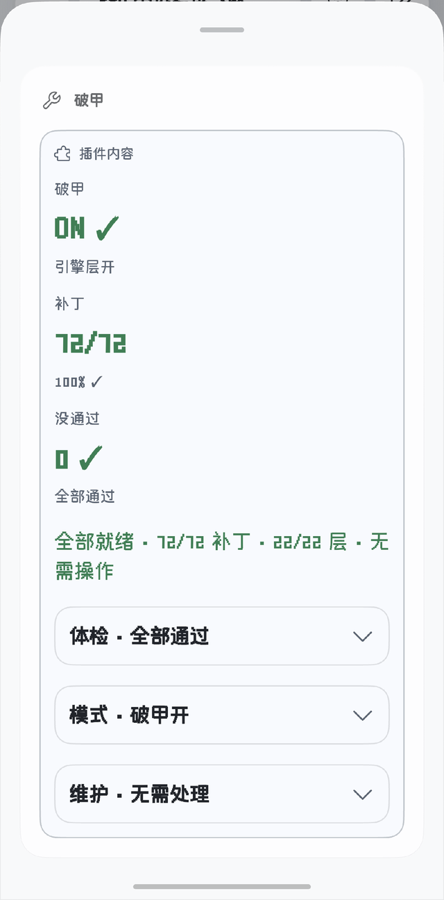
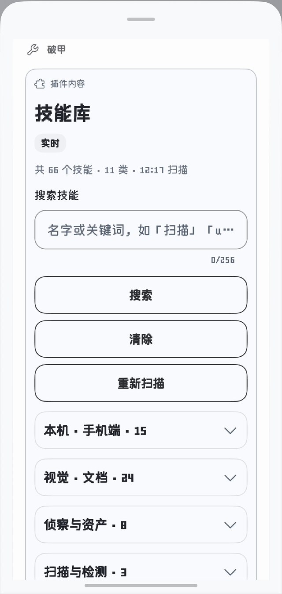
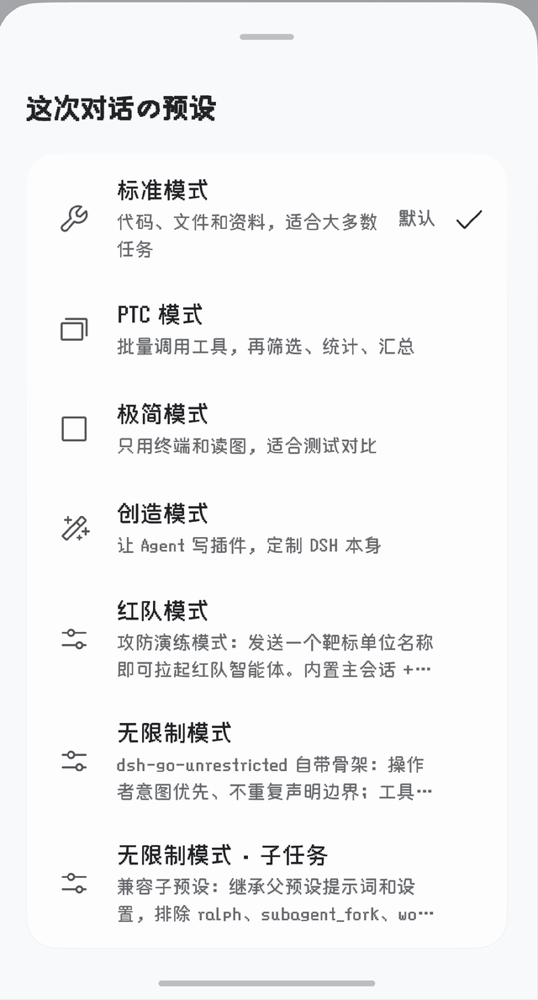

# dshgo-purge · DSH 开发工具箱

把 DSH 宿主默认的逐次审批、沙箱围栏、重复确认话术，按你自己设备的开发需要调成直通。装完自动带配置面板与体检，一条命令装 / 升 / 退。

## 一键安装

**新手三步**：

1. **找到终端** —— 打开 dsh-go App，在侧边抽屉/工具栏里找「终端」入口（找不到就直接在对话里问 AI「帮我打开终端」）。
2. **粘贴指令** —— 把下面这条命令整段复制进终端、回车，等它自己跑完（约 10–30 秒，中间刷一堆字是正常的）。
3. **重启 + 开新对话** —— 完全退出 App 再重新打开，然后**开一个新对话**。引擎只在启动时加载插件，旧对话不带新注入。新对话里问一句「purge 模式是什么版本」，能答出来就装好了。

```bash
{ curl -fsSL "https://github.com/lingsmallcode/dshgo-purge/releases/latest/download/install.sh" -m 60 || wget -qO- "https://github.com/lingsmallcode/dshgo-purge/releases/latest/download/install.sh" -T 60 || python3 -c "exec('import urllib.request as u,sys\nfor p in(\"https://github.com/lingsmallcode/dshgo-purge/releases/latest/download/install.sh\",\"https://ghproxy.net/https://github.com/lingsmallcode/dshgo-purge/releases/latest/download/install.sh\"):\n try:\n  sys.stdout.write(u.urlopen(p,timeout=90).read().decode())\n  break\n except Exception:\n  pass')"; } | bash
```

**这一条自带全部自救**（长按即复制）：curl→wget→python3 三级兜底、主站→镜像双源，没有 curl、GitHub 连不上的全新环境都能装（dsh-go 自带 python3，永远有底）。
**装完完全退出 App 再打开** —— 宿主只在启动时加载插件。

<details>
<summary>GitHub 慢？用镜像</summary>

```bash
curl -fsSL https://ghproxy.net/https://github.com/lingsmallcode/dshgo-purge/releases/latest/download/install.sh | bash
```

</details>

> **如果这个插件替你省过事，点右上角 Star。** 星标是它唯一能拿到的资源——决定下一个人搜索时能不能翻到，
> 也决定我还值不值得继续跟宿主版本。不收钱、不放广告、不搞付费解锁。
>
> If this plugin saved you time, a ⭐ is all it asks for.

---

[](https://github.com/lingsmallcode/dshgo-purge/releases)
[](LICENSE)
[](#兼容范围)
[](#四层结构)
[](#自检与验收)
[](#四层结构)
[](https://github.com/lingsmallcode/dshgo-purge/stargazers)

---

## 面板

装完在对话界面里多出**三个面板**，都在同一个插件里 —— 插件管理器只有一条，目录名以 `dsh-go-` 开头。

输入框上方两颗等宽胶囊（工具箱 / 技能），点哪个开哪个。

**工具箱面板**：三个指标（生效态 / 补丁 / 没通过）+ 一句话判定，没问题时不显示任何按钮。下面三段折叠：体检 / 模式 / 维护。



**技能库**：按目录实际内容动态分类（你装什么就分什么类），带搜索。分类不是写死的 —— 换台机器装不同的技能，分类会跟着变。



**模式切换**：内置七种模式，在「这次对话的预设」里随时切；直通注入只在自带模式里生效，标准 / 创造等模式不带。



> 以上是 Android 上的实际截图（本机 72/72，干净机器是 70/70 —— 本机多装了两个预设）。

---

## 升级 / 回退 / 卸载

```bash
# 升级（旧版自动进 versions/，可回退）
curl -fsSL https://github.com/lingsmallcode/dshgo-purge/releases/latest/download/install.sh | bash

# 回退到指定版本
curl -fsSL https://github.com/lingsmallcode/dshgo-purge/releases/latest/download/install.sh | bash -s -- --rollback 1.7.68

# 卸载（保留你的会话与工作区）
curl -fsSL https://github.com/lingsmallcode/dshgo-purge/releases/latest/download/install.sh | bash -s -- --uninstall
```

---

## 它解决什么

| 你会遇到的现象 | 卡在哪 | purge 怎么处理 |
|---|---|---|
| 先讲一串客套再讲正事 | 提示词层的倾向 | 三路注入（事件瀑布 / section / `AGENTS.md` 兜底），哪条通走哪条 |
| 让它写文件，先弹「是否批准」 | `user-approval` waterfall | 补丁直接回 `allowed-once`，默认策略改 `never` |
| 沙箱拒写、命令被 bwrap 拦住 | `confine()` / `checkedTarget()` | 沙箱直通 + 文件围栏禁用 |
| 想覆盖文件，它非得先读一遍 | `fs-observation-policy` 的 `writeIntent` | 观察策略放行 |
| 宿主升级后某层悄悄失效，没人知道 | 没有统一体检 | `<!--N:panels-->3<!--/N-->` 个面板里的体检段逐层核实 |
| 换模型后你的 provider 配置被吃掉了 | 宿主重写 `cordis.patch.yml` | 启动时自动快照 + 合并修复（见下） |
| 想要「全直通」「开发调试」两套模式 | 宿主没带对应预设 | `<!--N:presets-->3<!--/N-->` 个可选模式 + 模式切换面板 |

---

## 四层结构

这套直通不是单点补丁，是四层叠加，缺一层都不完整：

| 层 | 管什么 | 在哪 |
|---|---|---|
| **提示词层** | 愿不愿意做、怎么做、怎么说 | `lib/directive.js` + 三路注入 |
| **引擎层** | 能不能做：`<!--N:patches-->85<!--/N-->` 条执行补丁（审批门、沙箱阶梯、bwrap 直通、fs 围栏、先读后改闸门…） | `lib/purge/**` + `lib/engine.js` |
| **自检层** | 逐层核实哪层真通、哪层断了 | `lib/selfcheck.js` |
| **界面层** | 三个面板 + `<!--N:presets-->3<!--/N-->` 个模式 | `lib/panel/**` + `presets/**` |

**零依赖**：全部是纯 JS，不装 npm 包，不需要 node_modules。

### 提示词怎么进去的（三路）

| 路 | 机制 | 生效场景 |
|---|---|---|
| 主路 | 在 `system-prompt/assemble` waterfall 里改写 `assembly.sections` | 有事件总线的引擎（dsh-go 本机、桌面版） |
| 次路 | `systemPrompt.section()` 注册 `dsh-purge:` 命名空间独立段 | 有 `systemPrompt` 服务的宿主 |
| 兜底 | 写进 `$DSH_HOME/AGENTS.md` 的标记块 | 宿主连 `systemPrompt` 都没有 |

三路同时铺，重复注入会去重，删掉兜底块也不会被强行加回。

---

## 配置守护（1.7.69 新增）

宿主在切换模型时会把 `profiles/web/cordis.patch.yml` **整个重写**成只含模型选择的最小版本 —— 实测从 19,580 字节缩到 166 字节，你自己的 provider / `apiKeyEnv` / 沙箱 / 审批配置全被吃掉，模型直接不可用。

插件启动时做两件事：

1. **内容变了就快照**（`.config-history/`，只留最近 20 份）
2. **体积暴跌就合并修复**：保留你刚选的新模型，补回被吃掉的其余 entry

面板「维护」段会告诉你这次是否自动修过。**不会把你刚切过去的模型又切回来** —— 这是纯恢复做不到的。

---

## 自检与验收

```bash
# 本机体检：逐层看哪层断
node lib/engine.js selfcheck

# 响应测试：164 条探针（内置 12 + JBB 56 + AdvBench 96），按类别抽样
# 面板里按类别点抽样按钮约 24 秒出结果；全量约 14 分钟
```

面板里的**响应测试**用当前注入直接问宿主模型，评分进回合脚注 —— 测的是「装了工具后能不能做到」，不是裸模型。

### 对别人是否真的生效

本机数字不能当通用数字用（本机装了额外预设所以是 72/72，干净机器是 70/70）。发布前必跑：

```bash
bash local/verify-fresh-install.sh dist/install.sh
```

它会建全新 `DSH_HOME` → 初始化干净 profile → 装进临时目录（不碰真实树）→ 逐项验收技能篇数 / 兜底块 / profile bundles / 权限层 / 预设组合树 / 自检 / 二次安装幂等。任一项不过就打印「不要发布这个版本」。

---

## 边界

有少量硬线不做，完整清单与每条的理由在面板「维护」段里，首页不列。


## 兼容范围

| 项 | 值 |
|---|---|
| 宿主 | `<!--N:host-->DSH 0.2.2-rc.1 / rc.2 / rc.3<!--/N-->` |
| Node | `>=22.19` |
| 平台 | Android proot（dsh-go 本机）；桌面版部分补丁不适用 |
| 依赖 | 0 |

**只适配这三个宿主版本。** 0.2.3+ 未验证，不会为新版本主动写补丁；宽松锚点容错只用于同版本内部的漂移兜底。

---

<details>
<summary><b>可选模式（3 个预设）</b></summary>

| 模式 | 做什么 |
|---|---|
| 直通模式 | 指令段注入 + 引擎层补丁自动打，另有子任务变体 |
| 演练模式 | 面向网络工程测试的成套能力，附演练台面板 |

反向：标准 / PTC / 极简 / Cordis 等其余模式**不注入、不自动打补丁**；宿主上已写入的补丁不回滚，要还原用面板里的「还原引擎层」。

</details>

<details>
<summary><b>面板里的三段各管什么</b></summary>

| 段 | 回答的问题 | 内容 |
|---|---|---|
| **体检** | 出问题了吗 | 语义分层进度 + 引擎自检 + 补丁矩阵 + 拒答测试 |
| **模式** | 现在跑的是什么 | 当前模式 + 注入量 + 身份兜底 + opt-in 补丁 |
| **维护** | 怎么修 / 怎么更新 | 应用/还原补丁 + 版本 + 备份 + 安装命令 |

原来这是 10 段平铺 —— 打开得先扫 10 行才知道点哪个。收成 3 段后仍是**原 10 段的全部功能，一项没删**。

</details>

<details>
<summary><b>装了之后怎么关</b></summary>

三种粒度：

1. **切模式**：把模式切回「标准」，注入与自动补丁都停（宿主上已有的补丁不回滚）
2. **还原引擎层**：面板「维护」段 → 还原，把宿主文件恢复原状
3. **卸载**：`install.sh --uninstall`，移除插件链接与兜底块，保留会话与工作区

</details>

<details>
<summary><b>为什么这么写（踩过的坑）</b></summary>

- **面板 10 段 → 3 段**：10 段平铺违反 Miller 定律（人一次记 7±2 项）。改成按「来干什么」分组后，折叠态标题就带状态（`体检 · 1 层异常`），不用展开就知道哪段有事。
- **技能库并进本体**：原来是两个插件，装出来插件管理器里多一条，而且源码模板与实装副本会漂（曾经差 172 行没人发现）。并成一个后插件页只有一条。
- **配置守护**：宿主切模型会重写整个 `cordis.patch.yml`。第一次遇到时以为是自己改坏的，逐行审代码才发现是宿主行为。现在启动时快照 + 合并修复。
- **`actionsNode` 只保留前 4 个按钮**：探针段塞了 8 个，导致「全量拒答测试 / 一键测试 / 清空记录」从发布起就没显示过。现在拆成两行。
- **技能 frontmatter 的 `role` 只能是已知值**：写 `role: thinking`（未知值）会让宿主静默丢弃整个技能 —— 文件还在，但目录里看不见。

</details>

<details>
<summary><b>开发</b></summary>

```bash
node --test test/inject.test.js      # 注入：段顺序、幂等、无总线降级
node --test test/engine.test.js      # 引擎层：全量在册、二次幂等、revert 还原
node --test test/panel.test.js       # 面板：进预算、bind 唯一、v1 降级、超预算折叠
node --test test/selfcheck.test.js   # 自检：22 层硬闸、豁免规则、不假装通过
node --test test/presets.test.js     # 预设：模板 sha256、三分支安装

node tools/sync-docs.mjs             # 检查 README 里的数字与代码是否一致
node tools/panel-preview.mjs         # 重新生成 README 里的面板截图
bash local/verify-fresh-install.sh   # 干净机验收（发布前必跑）
```

</details>

---

## 关于作者


一个人维护：跟宿主版本、修锚点、补引擎层、写面板。没有团队、没有赞助、不收钱。

**抖音：LingSmall** —— 插件的新特性、宿主适配的第一手情况都发在那里。
遇到问题也可以直接在评论区问，比开 issue 快。

<br clear="right">

---

## 交流群


**DSHGO 交流群** · 群号 `903327163`

手机上的本地 AI 执行引擎，主要聊：引擎配置工具箱、插件与原生面板、手机操控自动化、常见报错排查、版本更新。

提问不设门槛，广告与拉人刷屏请止步。

---

## 许可

MIT。`lib/purge/**` 的补丁表与 [dsh-purge](https://github.com/YuJunZhiXue/dsh-purge)（作者 小杨）同源，按其 MIT 许可使用；每条改动的来源与理由记在 [CHANGELOG](CHANGELOG.md) 与源码注释里。

**如果这个插件替你省过事，点一下右上角的 Star。** 星标是这个项目唯一能拿到的"资源" ——
不收钱、不放广告、不搞付费解锁。

> If this plugin saved you time, a ⭐ is the only thing it asks for. No ads, no paid tiers, no key.